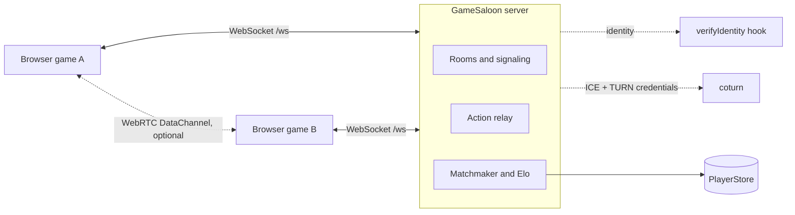

<div align="center">

# GameSaloon

**An open-source WebSocket game server for web games: rooms, relay, and Elo matchmaking, in one small Node/TypeScript module.**

[](./LICENSE)
[](./package.json)
[](#contributing)

[Quickstart](./docs/quickstart.md) · [Protocol](./PROTOCOL.md) · [Docs](#documentation) · [Commercial licence](./COMMERCIAL.md) · [Try the hosted version](https://gameserver.etcito.com)

</div>

---

GameSaloon (formerly "Handshake" / kart-rooms) is the **handshake and lobby layer** for browser games: room codes, lobbies, WebRTC signaling, a WebSocket action relay, quick/ranked matchmaking with an Elo rating, and identity verification. Your game stays in charge of the game rules.

That is the core, and it is all you get out of the box with zero setup. The code also contains optional per-player services (a coin and card-pack economy, cloud saves, stats, achievements, player content, payments) that need somewhere to keep their data. So there are three ways to use GameSaloon:

| | What you get | What you need |
|---|---|---|
| **1. Lobby only** (memory store, zero setup) | Rooms, relay, signaling, quick/ranked matchmaking, Elo, guest/Wavedash identity | Nothing. State lives in memory and is lost on restart. **In memory mode the economy, saves, stats, achievements and player-content services have no data** (no catalog, no products, nothing persisted); do not rely on them. |
| **2. Bring your own database** | Everything above plus the economy and online services, with your data in your storage | Implement the `PlayerStore` / `TableApi` contract on your own database ([docs/stores.md](./docs/stores.md)); a contract test suite checks it. **Honest status:** the only non-memory store shipped here (`PLAYER_STORE=http`) targets a CRM-style remote table API (the one the Etcito hosted service exposes). A ready-made generic SQL adapter is **not shipped yet**, so today this path means writing your own adapter. |
| **3. Use Etcito (hosted)** | The same server operated for you, with the table backend, economy, saves, achievements, payments and creator tooling | An account at [Etcito](https://gameserver.etcito.com), the hosted service built on GameSaloon. |

It has one runtime dependency (`ws`), runs TypeScript directly on Node 22.18+ (no build step needed to run it), and can run standalone or be embedded in your own Node process.

## Why GameSaloon

- **You own the server.** Run it on one VM, behind your own reverse proxy. No per-player pricing, no lock-in to a platform.
- **Small and readable.** One runtime dependency, a typed `dist/` for embedding, a written wire protocol.
- **Pluggable storage.** Player data goes through a Promise-based `PlayerStore` interface (plus a small `TableApi` for the per-player services). Start with the in-memory store; a contract test suite checks your own implementation.
- **Honest scope.** It does rooms, relay, matchmaking and the per-player services below. It does not run your game simulation, and it does not ship an account system: you plug in identity verification.

## Features

What is in the code today:

- **Rooms.** 5-character room codes, up to 8 machines and 8 human players per room, up to 4 local players per machine; public room listing (per game) and private rooms joined by code; room settings and a server-drawn start seed. See [PROTOCOL.md](./PROTOCOL.md). (The player shapes in the rooms protocol come from the kart game this server was extracted from.)
- **WebRTC signaling.** Offers, answers and ICE candidates are forwarded between room members. The server hands out ICE servers, with short-lived TURN REST credentials when you configure a coturn `TURN_SECRET`. In this mode it never relays race data: peers talk over DataChannels.
- **Action relay.** A second protocol on the same `/ws` endpoint for games that want the server in the loop: 2-4 seat private rooms by code, a public FIFO queue, sequenced `act` messages with acks, and resume tokens to survive short disconnects (see [docs/RELAY.md](./docs/RELAY.md)).
- **Quick and ranked matchmaking.** Two queues, `quick` and `ranked`. Ranked matches within a rating window that widens the longer a player waits. An optional "resident" opponent hook can fill in when nobody is found.
- **Elo ratings.** Start rating 2500, placement games, a decreasing K factor, and tiers (Bronze, Gold, Platinum, Diamond, Master). Both players report the result; disagreement voids the match and a missing report forfeits after a timeout.
- **Pluggable identity.** A `verifyIdentity` hook turns a provider token into a verified identity. Built in: `guest` tokens, and `wavedash` user tokens (verified on the server against Wavedash's published keys). `itch` is not wired by default.
- **Economy (optional).** Server-authoritative coins, card packs, a collection, rewards and a coin shop, driven by a JSON catalog you provide; paid purchases through Wavedash receipts (client message or webhook) and Stripe Checkout. Every operation is idempotent and journaled; refunds reverse a purchase, and the balance never goes below zero. See [docs/economy.md](./docs/economy.md). Stripe needs an external "bridge" service that holds the Stripe secrets (this server holds none); that bridge is not in this repository, so Stripe selling is only available if you provide one. Coins, packs and Wavedash purchases need a table-API store (choice 2 or 3 above); with the default memory store there is no catalog and no data.
- **Cloud saves, stats, achievements, player content (optional).** Versioned saves with compare-and-set, server-maintained and client-reported stats, data-driven achievements, and bounded user-generated content, all with quotas. See [docs/online-data.md](./docs/online-data.md).
- **Several games on one server.** A game is a string; ratings, queues and rooms are kept per game. With a table-API store you can configure one store per game, and an opt-in "multi-creator" mode adds a hot-reloaded game registry, per-game caps and a strict `hello`. See [docs/multi-game.md](./docs/multi-game.md). **Self-hosters, note:** in that mode a game is either an "owner game" (exempt from the creator caps) or a creator game. Owner games are configuration: the `OWNER_GAMES` environment variable, a comma-separated list of game names, empty by default, so by default every game gets the creator caps.
- **Stores.** `PLAYER_STORE=memory` (default, nothing persisted) or `PLAYER_STORE=http`, which stores rows through a remote table API (`createCrmTableApi`, the API of the Etcito hosted service). There is no SQL store in this repository; you can implement `PlayerStore` / `TableApi` on your own database (see [docs/stores.md](./docs/stores.md)).
- **Operations basics.** `GET /health`, per-connection rate limiting, `MAX_ROOMS` / `MAX_CLIENTS` caps, an `ALLOWED_ORIGINS` check, a log level, and example systemd / Caddy / nginx / coturn files in [`deploy/`](./deploy).
- **Build publisher (optional, Etcito-specific).** `src/publisher` is a separate process (`npm run publisher`) that pushes game builds to Wavedash / itch.io with their command-line tools. It is part of the hosted Etcito workflow, needs those tools and an Etcito-side client, and is not needed to run a game server.

Not in the code (so not promised): a built-in SQL database store, a hosted dashboard or account system in this repository, or client SDKs for specific engines.

## Quickstart

```sh
git clone https://github.com/Etcito/gamesaloon.git && cd gamesaloon
npm install --omit=dev
npm start
```

The server listens on `127.0.0.1:8787`; check `http://127.0.0.1:8787/health` and connect WebSocket clients to `/ws`. For a first client, see [`examples/hello-client.mjs`](./examples/hello-client.mjs); for the full walkthrough, [docs/quickstart.md](./docs/quickstart.md); to run it in a container, [`docker-compose.yml`](./docker-compose.yml). Every environment variable is listed in [`.env.example`](./.env.example) and [docs/configuration.md](./docs/configuration.md).

Embedding it in your own process (the package is named `gamesaloon`; it is not published to npm yet, so build it with `npm run build` and depend on a checkout or a tarball):

```ts
import { createHandshake, createMemoryStore, guestIdentity } from 'gamesaloon'

const server = createHandshake({
  config: { port: 8787, host: '127.0.0.1' },
  store: createMemoryStore(),
  hooks: {
    verifyIdentity: async (provider, token, name) =>
      provider === 'guest' ? guestIdentity(token, name) : null,
    pickResident: async () => null,
    onMatchEnd: (record) => console.log(`match ${record.match_id}: ${record.status}`),
  },
})
await server.listen()
```

(`createHandshake` keeps its historical name. Some internal names, `ETCITO_*` variables and `etc_*` table names, also predate the GameSaloon name; the code expects them verbatim.)

## Architecture



The server speaks JSON over one WebSocket endpoint. Rooms, relay, match, economy and online-data messages share it. State that must survive a restart goes through your `PlayerStore` / `TableApi`; rooms live in memory.

## Documentation

| Document | What it covers |
|---|---|
| [Quickstart](./docs/quickstart.md) | Run it and connect a first client |
| [Protocol](./PROTOCOL.md) | The room / signaling wire protocol |
| [Relay protocol](./docs/RELAY.md) | The action relay, queue and resume |
| [Configuration](./docs/configuration.md) | Environment variables and options |
| [Stores](./docs/stores.md) | The `PlayerStore` contract and writing your own |
| [Economy](./docs/economy.md) | Coins, packs, purchases, refunds, webhooks |
| [Online data](./docs/online-data.md) | Cloud saves, stats, achievements, player content |
| [Several games](./docs/multi-game.md) | Per-game stores, multi-creator mode, caps |
| [Matchmaking and Elo](./docs/matchmaking-and-elo.md) | Queues, windows, ratings, tiers |
| [Deploying](./docs/deploying.md) | systemd, reverse proxy, coturn, Docker |
| [Client integration](./docs/client-integration.md) | Wiring a browser game to the server |
| [Licensing FAQ](./docs/licensing-faq.md) | What AGPL-3.0 means for your game |

## Licensing

- **The server is AGPL-3.0.** You may use, modify and self-host it. If you run a modified version as a network service, the AGPL requires you to offer your users the corresponding source. See [LICENSE](./LICENSE).
- **Protocol documentation is MIT.** [LICENSE-MIT](./LICENSE-MIT) covers `PROTOCOL.md`, `docs/RELAY.md` and any client example code, so you can build a client without copyleft obligations. See [LICENSING.md](./LICENSING.md) and the [licensing FAQ](./docs/licensing-faq.md) for exactly which files.
- **Commercial licence.** If AGPL does not fit your product, a commercial licence is available: see [COMMERCIAL.md](./COMMERCIAL.md) or write to contact@etcito.com.

## Contributing

Issues and pull requests are welcome. Read [CONTRIBUTING.md](./CONTRIBUTING.md) first; contributions require agreeing to the [CLA](./CLA.md), which is what lets the project offer a commercial licence alongside AGPL.

```sh
npm install
npm test          # node:test, in-process fakes, no network
npm run typecheck
```

## Hosted: Etcito

[Etcito](https://gameserver.etcito.com) is the hosted service built on GameSaloon, run by the same people, for teams that would rather not operate a server. Its management backoffice is private and not part of this repository.
